<div align="center">

<picture>
  <source media="(prefers-color-scheme: dark)" srcset="docs/images/hero-dark.png">
  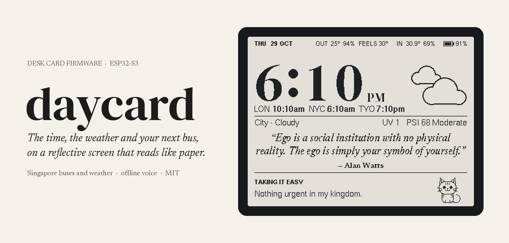
</picture>

**Firmware that turns a Waveshare ESP32-S3-RLCD-4.2 into a calm desk card for Singapore.<br>
Live LTA bus arrivals, NEA weather, world clocks, a quote every half hour, a focus garden,<br>
and a small cat that answers to your voice without anything leaving the board.**

[](LICENSE)
[](https://www.waveshare.com/esp32-s3-rlcd-4.2.htm)
[](https://arduino.github.io/arduino-cli/latest/installation/)
[](#what-leaves-the-board)

[What it shows](#what-it-shows) · [What you need](#what-you-need) · [Quick start](#quick-start) · [Make it yours](#make-it-yours) · [Voice](#voice) · [Troubleshooting](#troubleshooting) · [Contributing](CONTRIBUTING.md)

<br>

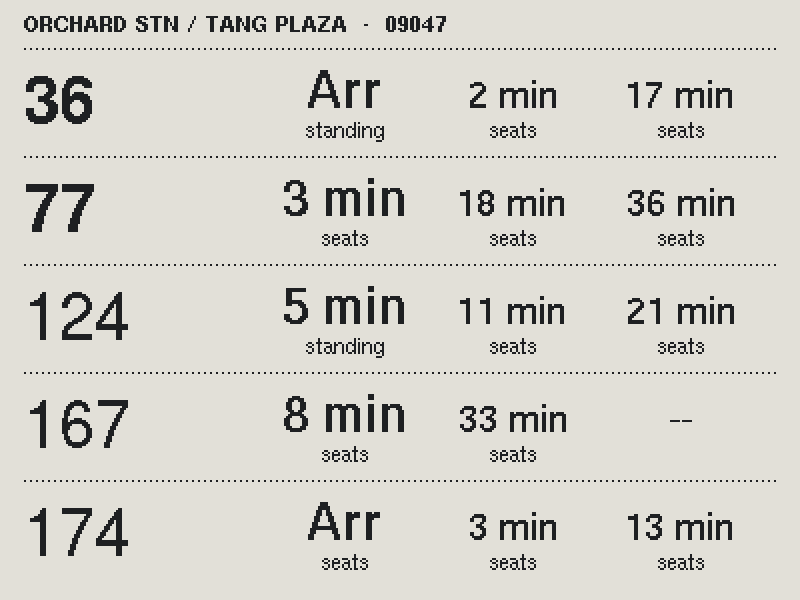

<sub>Real screens, captured from the board's framebuffer with the example config.</sub>

</div>

<br>

Glance at it and you know:

- *Is my bus close?* The next three arrivals at your stop, with how full each bus is.
- *Will it rain in the next two hours?* NEA's forecast for your area, drawn as one of ten weather scenes.
- *Is the haze bad today?* The 24-hour PSI for your region, with a notice when it turns unhealthy.
- *What time is it for the people I call?* Three world clocks that follow their own daylight saving.

The screen is a reflective LCD that needs no backlight, so it reads like paper in daylight and doesn't light up
the room at night.

---

## What it shows

<table>
<tr>
  <td align="center" width="33%">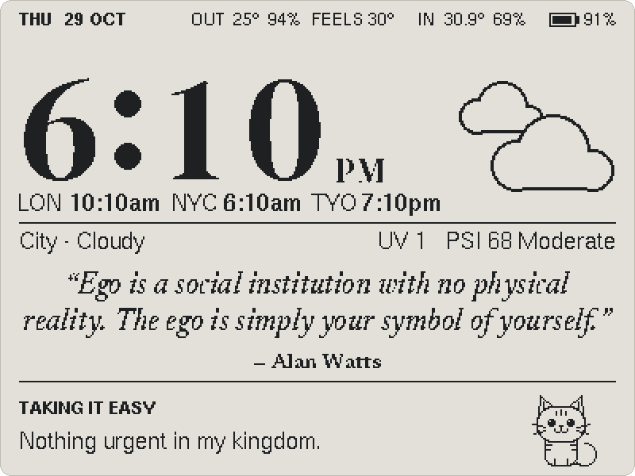<br><b>The card</b><br><sub>Clock, world clocks, weather, a quote</sub></td>
  <td align="center" width="33%">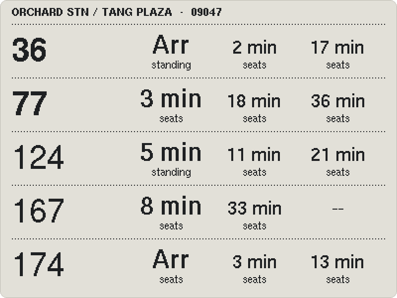<br><b>Bus board</b><br><sub>Next three arrivals, with crowding</sub></td>
  <td align="center" width="33%">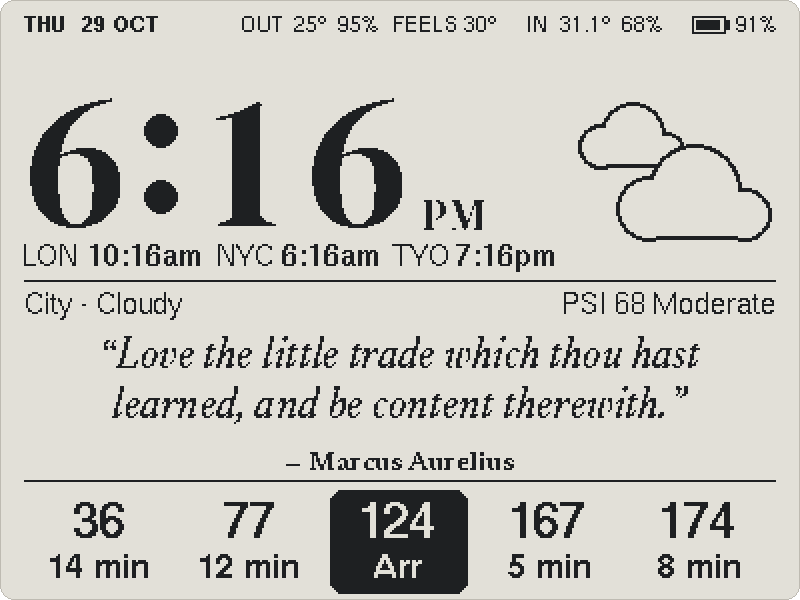<br><b>Mornings</b><br><sub>Your buses along the bottom, 7 to 10 AM</sub></td>
</tr>
<tr>
  <td align="center">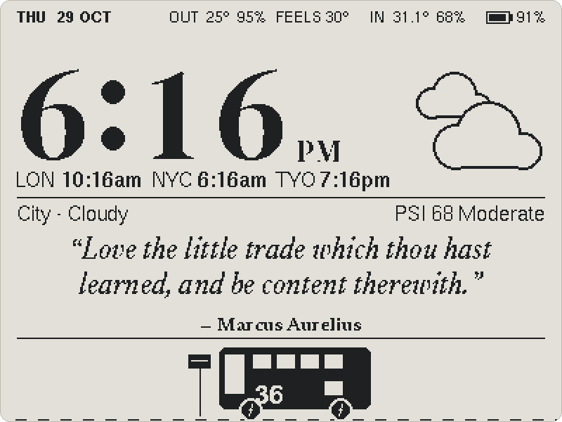<br><b>Drive-by</b><br><sub>A bus pulls up when one is a minute out</sub></td>
  <td align="center">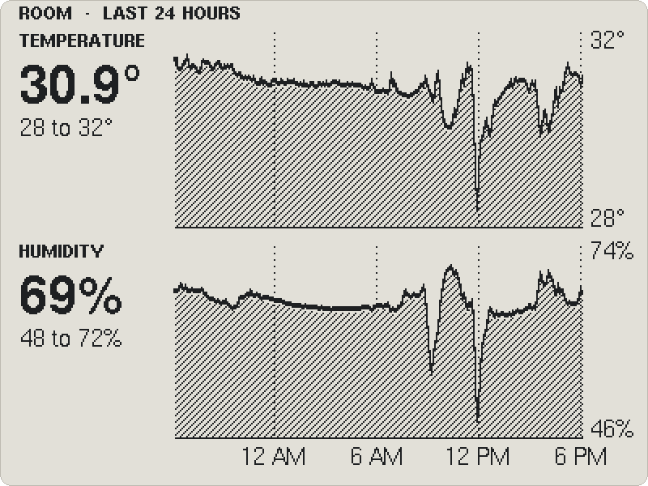<br><b>Room</b><br><sub>24 hours of temperature and humidity</sub></td>
  <td align="center">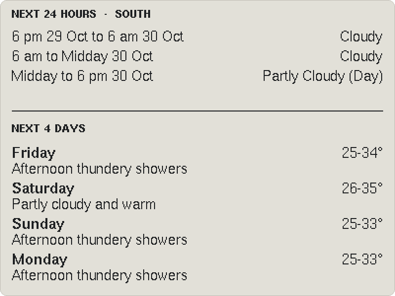<br><b>Forecast</b><br><sub>The next 24 hours and four days</sub></td>
</tr>
<tr>
  <td align="center">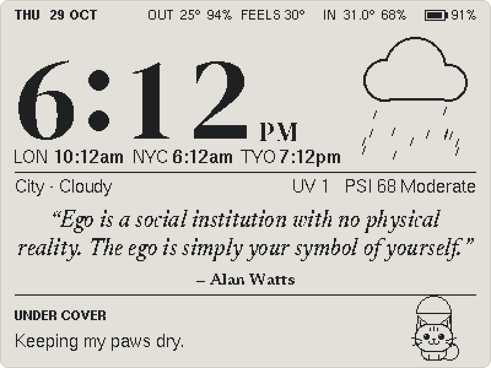<br><b>Rain</b><br><sub>The cat takes an umbrella</sub></td>
  <td align="center">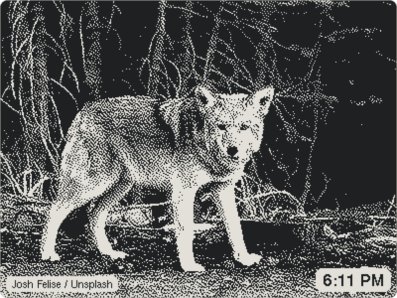<br><b>Photo frame</b><br><sub>Quiet evenings: nature photos and your own</sub></td>
  <td align="center">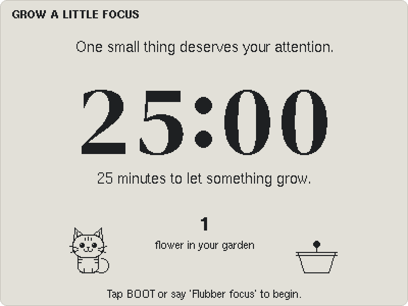<br><b>Focus</b><br><sub>25 minutes grow one flower in a garden</sub></td>
</tr>
</table>

<p align="center">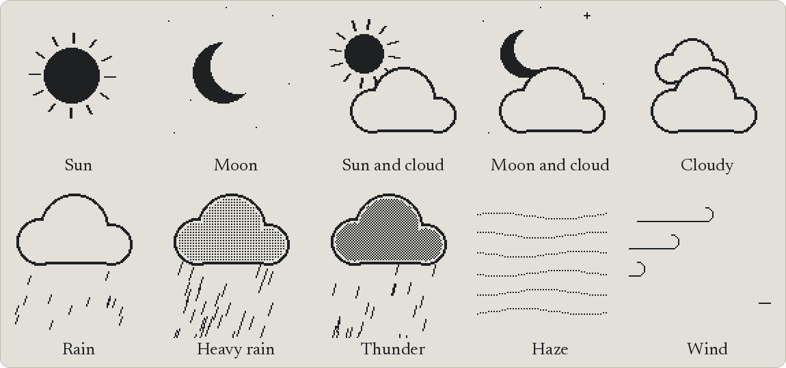<br>
<sub>Ten weather scenes, picked from NEA's 2-hour forecast and animated on the card.</sub></p>

<p align="center">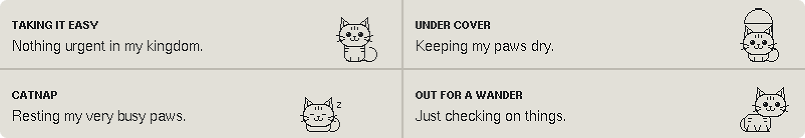<br>
<sub>The cat (Flubber, unless you rename it) blinks, strolls, naps and shelters from the rain, with a caption for each.</sub></p>

---

## What you need

- A [Waveshare ESP32-S3-RLCD-4.2](https://www.waveshare.com/esp32-s3-rlcd-4.2.htm) and a USB-C data cable.
- A free LTA DataMall AccountKey ([request one](https://datamall.lta.gov.sg/content/datamall/en/request-for-api.html)).
- 2.4 GHz Wi-Fi.
- Optional: a microSD card (FAT32, 32 GB or smaller) for photos, the room chart and logs, and an 18650 cell to run
  on battery.
- A computer with [arduino-cli](https://arduino.github.io/arduino-cli/latest/installation/) (macOS:
  `brew install arduino-cli`). The first build downloads about 1.7 GB of ESP32 toolchain (6 GB once unpacked).

Buses and weather come from Singapore's LTA DataMall and NEA, so outside Singapore you'd get the clock, quotes, room
readings, focus timer and photos, but no buses or weather.

## Quick start

1. Fork this repo, then clone it into a folder named `daycard`, since arduino-cli needs the folder to match
   `daycard.ino`:

   ```sh
   git clone https://github.com/<your-account>/daycard-sg.git daycard && cd daycard
   ```

   A GitHub ZIP unpacks as `daycard-sg-main`; rename that folder to `daycard`.
2. Open `config.h` and set your stop, services and area ([Make it yours](#make-it-yours) lists every setting and
   where to find its value). It ships with a working example at Orchard, so you can flash first and edit later.
3. Optional but wise: back up the factory firmware (see [Restore the factory firmware](#restore-the-factory-firmware)).
4. Plug the board in, find its port with `arduino-cli board list` (`/dev/cu.usbmodem…` on a Mac, `/dev/ttyACM0` on
   Linux, `COM3` or similar on Windows), then build and flash from this folder:

   ```sh
   arduino-cli compile --build-property upload.maximum_size=6291456 .
   arduino-cli upload -p /dev/cu.usbmodem* .
   ```

   `sketch.yaml` pins the board settings, the ESP32 core (3.3.12) and the libraries (U8g2, ArduinoJson 7,
   WiFiManager 2.0.17), so the first compile fetches exactly those.
5. Give it about 30 seconds. On first boot the screen shows a Wi-Fi network (`Daycard-Setup`) and a password that
   changes every boot. Join it from your phone, choose Configure WiFi and pick your 2.4 GHz network. Once the board
   joins it, the setup network closes. Hold KEY for 3 seconds to open it again, rejoin, choose Setup and paste your
   LTA AccountKey. Both stay on the board only.

<p align="center">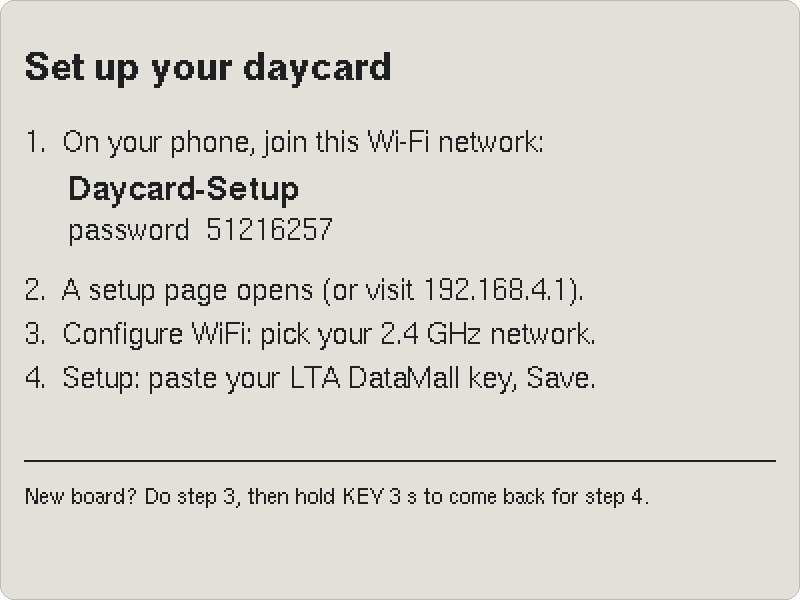</p>

Reflashing keeps the saved Wi-Fi and key. Over USB, sending `K<key>` and a newline also sets the key.

## Make it yours

Everything you'd change is in `config.h`. To keep your settings out of git, copy it to `config.local.h` and edit
that instead: the build prefers it, and `.gitignore` skips it.

| Setting | What it does | Where to find yours |
|---|---|---|
| `BUS_STOP`, `BUS_STOP_NAME` | The stop and the name on the bus board | The five-digit code on the bus stop pole |
| `BUS_SERVICES`, `MY_BUSES` | Up to five services, and which ones are bold | The services listed on the pole |
| `NEA_AREA` | The area for the 2-hour forecast | An area name from NEA's [2-hour forecast](https://api-open.data.gov.sg/v2/real-time/api/two-hr-forecast) |
| `REGION` | PSI and the 24-hour forecast | The nearest of north, south, east, west, central |
| `AIR_STATIONS` | Outside temperature, humidity and wind | Station IDs from NEA's [air temperature](https://api-open.data.gov.sg/v2/real-time/api/air-temperature) feed, nearest first |
| `WORLD_CLOCKS` | Three clocks under the time | A label, the standard UTC offset in minutes, and a DST rule (`NO_DST`, `US_DST`, `EU_DST`, `AU_DST`, `NZ_DST`) |
| `CALL_NAME` | The cat's name and the word that starts every voice command | Anything two or three syllables long |
| `MORNING_HOUR`, `WORK_HOUR`, `EVENING_HOUR` | When buses, focus and the photo frame take over | Your own day |
| `QUOTE_AUTHORS` | The Wikiquote pages quotes come from | Page titles as they appear in the URL |
| `TEMP_OFFSET_C`, `RH_OFFSET` | Calibration for the indoor sensor | A room thermometer (see [Changing things](#changing-things)) |

The build stops with a clear message if you list more than five services or anything other than three clocks.

## It's working if…

- Within a minute of joining Wi-Fi, the status row names your area with a forecast, and UV and PSI have numbers.
- Tap KEY once: the bus board header shows your stop's name and code, with minutes next to your services (buses run
  from about 5:30 AM to midnight).
- The three world clocks show your labels at the right times.
- Saying "*your name*, next bus" opens the bus board.

If any of these fail, [Troubleshooting](#troubleshooting) covers the usual causes.

## Using it

Tap KEY to step through the views: card, bus board, room history, forecast, photos, focus timer and garden. Bus,
room and forecast return after a minute, to focus if a session is running, otherwise to the card. KEY takes you from
the garden back to the card.

BOOT starts a 25-minute focus session followed by a five-minute break. A plant grows into a flower, with a soft
chime at each boundary. Tapping again returns to the running session; holding BOOT for two seconds stops it.
Sessions run while you browse other views and keep automatic photos away; a restart cancels the session.

The permanent garden gets one flower for every completed 25-minute work phase, even if you stop during the break.
Cancelled work earns none. It keeps your lifetime flower count, this month's count and total focus hours, and draws
the latest 30 flowers with the cat beside them. Counts survive restarts: a snapshot is saved on the board and
appended to `daycard/garden.log` on the card, with versioned checksums so incomplete writes are skipped on recovery.

The cat sits on the card's work and evening footer and in the focus garden. It blinks, gets sleepy late at night,
carries an umbrella under a fresh rainy forecast, and celebrates the switch from focus to break. Every 90 seconds it
takes a short stroll, then stretches, washes a paw or naps before returning to its spot. It stays settled during
focus. Short captions follow what it's doing; the focus hint appears for up to eight seconds every five minutes.

The day follows a routine in Singapore time. From 7 to 10 AM buses run along the bottom; from 10 AM to 6 PM the
card favours the clock and focus; from 6 PM to 7 AM, after `IDLE_MINUTES` (5) of quiet, the card becomes the photo
frame. Talking, a loud sound, a button or a voice command brings the card back; sound stands in for motion, since
the board has no motion sensor. Photo and focus views you open yourself stay until you leave them.

The middle panel normally shows a quote, alternating every 20 seconds with today's intention when one is set.
Fresh 24-hour PSI of 101–200, heavy or thundery forecasts, connection trouble and overdue feeds trigger notices for
12 seconds, repeating every two minutes while the condition lasts. PSI of 201 or more stays up until it improves.
PSI categories follow [NEA's guide](https://www.haze.gov.sg/docs/default-source/posters/haze-pm-psi-guide-a4-yoca-english_18-oct.pdf).

### Daily intention

`python3 tools/intention.py "Finish one useful thing"` sends a note over USB: up to 56 printable ASCII characters,
or `""` to clear it. Add `--port /dev/cu.usbmodem…` when more than one board is attached. The note shows on the card
when no alert has priority and on the focus view throughout a session. It survives restarts, expires at midnight
Singapore time, and isn't echoed to serial logs. The clock must be set first.

### Photos

The frame shows JPEGs from the `photos` folder on the memory card, a new one every `PHOTO_MINUTES` (5).
`python3 tools/nature.py out && python3 tools/upload.py out/*.jpg` fetches 227 hand-picked Unsplash nature photos
(via Lorem Picsum, credited on screen) and copies them over USB. Your own JPEGs go in the same folder, or over USB
with `tools/upload.py`. The board only decodes baseline JPEGs: convert iPhone HEICs first
(`sips -s format jpeg -Z 1600 IMG.HEIC --out IMG.jpg` on a Mac); progressive JPEGs are skipped.

### Memory postcards

Add a personal photo with its own date and caption:

```sh
python3 tools/memory.py photo.heic --date 2024-09 --caption "Beach trip"
```

Use `YYYY-MM` or `YYYY-MM-DD` and 1–56 printable ASCII characters. The helper fixes orientation, resizes to at most
1200 pixels and writes a baseline JPEG with Pillow; HEIC/HEIF conversion uses macOS `sips`. The frame alternates
postcards with nature photos, favouring the same month on every other turn and labelling exact days "On this day".
With `--card /Volumes/DAYCARD` (or any folder) the helper writes to a mounted card instead of USB. Each postcard is
a JPEG plus a matching `.jpg.json` sidecar in `memories/`; keep both together.

### Quotes

Every `QUOTE_MINUTES` (30) the board reads one author's Wikiquote page from `QUOTE_AUTHORS` and picks a sourced line
that fits two lines of the card and hasn't shown in about ten days. Each is logged to `daycard/quotes.log` on the
card. Until the first one arrives after a restart, the card shows 49 built-in quotes.

## Voice

Say the whole phrase, starting with the name. It runs offline on Espressif's ESP-SR (MultiNet 7, English).

| Say | Does |
|---|---|
| Flubber, next bus / show the buses / bus times | bus board |
| Flubber, show the forecast / will it rain / weather | forecast |
| Flubber, show the room / show room / room temperature | room chart |
| Flubber, show photos / photo frame | photo frame |
| Flubber, go home / main screen | the card |
| Flubber, next quote | fetch a new quote now |
| Flubber, focus | start a focus session, or return to the running one |
| Flubber, stop | stop the focus session |
| Flubber, show garden / my garden | the garden |

Swap "Flubber" for your own `CALL_NAME`. There's no trained wake word, so the recogniser listens continuously for
whole phrases with one mic, and the name does the wake word's job. Phrases live in `voice.h`; `python3
tools/voicetest.py 3` runs prompted rounds and reports what was heard and how fast. Test with a person speaking;
laptop speakers usually don't reach the mic.

## What leaves the board

The board makes HTTPS requests to LTA DataMall (bus arrivals, with your key), data.gov.sg (NEA weather, UV, PSI) and
Wikiquote (quotes), and asks public NTP servers for the time. Voice is recognised on the board and no audio goes
over the network (the `A` serial command can record 8 seconds to USB for debugging). Wi-Fi details and your LTA key
stay in the board's flash, and photos stay on its memory card.

## Troubleshooting

| What you see | Usual cause |
|---|---|
| `main file missing from sketch` when compiling | The folder isn't named `daycard`; rename it |
| `ctags: bad CPU type in executable` | Apple Silicon without Rosetta: `softwareupdate --install-rosetta --agree-to-license` |
| `Sketch too big` | The size override is missing: keep `--build-property upload.maximum_size=6291456` |
| "Add your LTA DataMall key" on the bus board | Hold KEY for 3 seconds, rejoin `Daycard-Setup`, choose Setup and paste the key |
| Empty bus rows | Overnight there are none; otherwise check `BUS_STOP` and that each service calls there |
| No forecast for your area | `NEA_AREA` must match NEA's area name exactly, including capitals and spaces |
| The cat stops hearing you | Usually weak Wi-Fi starving the recogniser: move anything off the board and check `wifi` in `i` over serial |
| Stuck on the setup screen | The network must be 2.4 GHz; join `Daycard-Setup` again and re-enter it |

Over USB serial, `i` reports status (Wi-Fi strength, voice, memory card) and `f` shows when each feed last
succeeded.

## Self-healing

It's meant to run unattended. Every 30 s it rejoins Wi-Fi if it dropped, rebuilds the connection if no feed has
succeeded for 20 minutes, and restarts after 45 minutes without data, when memory runs low, and nightly at 4 AM. A
task watchdog restarts it if the display loop or network task stops for 2 minutes. With a network saved, a restart
never parks on the setup screen. The real-time clock keeps time across restarts while offline, and every boot is
logged with its reason to `daycard/restarts.log`.

## Build notes

- `partitions.csv` replaces the `esp_sr_16` partition table with one 6 MB app instead of two 3 MB OTA slots,
  because the speech recogniser alone is about 2 MB. `esp_sr_16` is still selected so the upload also writes the
  speech models to 0xC10000, and `--build-property upload.maximum_size=6291456` lifts the 3 MB size check. Leave all
  three as they are.
- `LoopCore=0` puts the display on core 0 so the recogniser has core 1 to itself; sharing a core, it fell to about
  70% of real time and missed words.
- The Arduino IDE can't pass the size override, so build with arduino-cli.

## Restore the factory firmware

Before your first flash, save the whole 16 MB flash with [esptool](https://github.com/espressif/esptool)
(`pip install esptool`, or `uvx esptool` with uv):

```sh
esptool --port /dev/cu.usbmodem* read-flash 0 0x1000000 factory-flash-16MB.bin
```

To go back to stock later:

```sh
esptool --port /dev/cu.usbmodem* write-flash 0 factory-flash-16MB.bin
```

## Changing things

- Indoor temperature reads high because the SHTC3 sensor sits beside the warm ESP32. Put a room thermometer next to
  the card, read the serial command `i` at the same moment, set `TEMP_OFFSET_C` = meter − raw, flash, then set
  `RH_OFFSET` = old `RH_OFFSET` + meter humidity − shown humidity (the shown value already includes the old
  offset). Get the temperature right first: humidity is corrected for it.
- Built-in quotes and type: edit `tools/quotes.txt`, then
  `uv run --no-project --with pillow python tools/make_assets.py` to re-render `assets.h`. On a Mac with Homebrew,
  prefix it with `DYLD_LIBRARY_PATH=/opt/homebrew/lib` so Pillow uses raqm layout, which the committed bitmaps were
  made with; without it every quote shifts by a pixel or two.
- New view: add it to `enum View`, write a `draw…` function, and add it to the render chain in `loop()`.
- New voice phrase: add it to `VOICE_COMMANDS` in `voice.h` and handle it in `handleVoice()`.

## Development

Host tests, no board needed:

```sh
c++ -std=c++17 tools/test_logic.cpp -o /tmp/t && /tmp/t                 # parsing, timing, DST, quotes, battery
c++ -std=c++17 tools/test_keepsakes.cpp -o /tmp/keepsakes && /tmp/keepsakes  # garden snapshots, postcard dates
python3 -m unittest discover -s tools -p test_memory.py                   # photo preparation, USB protocol
```

The board talks over USB serial with single-letter commands: `i` status, `f` feed ages, `F` focus status, `G`
garden counts, `C` the phrases the recogniser holds, `p` next view, `s` sample data, `d` framebuffer dump, and more
in `handleInput()` in `daycard.ino`. `python3 tools/grab.py shot.png [commands] --wait 1` screenshots the real
framebuffer. [CONTRIBUTING.md](CONTRIBUTING.md) covers checking a change on the board and refreshing these README
images.

If you use Claude Code, `.claude/skills/daycard` holds the working knowledge (pins, debugging, gotchas) and
`.claude/skills/verify-daycard` is a scripted way to flash a build and prove it on the board.

## License

MIT, see [LICENSE](LICENSE). The display driver (`ST7305_U8g2.*`) is Waveshare's, under Apache 2.0; the fonts in
`tools/fonts/` are under the SIL Open Font License. Photos in the frame come from Unsplash and are credited on screen.
